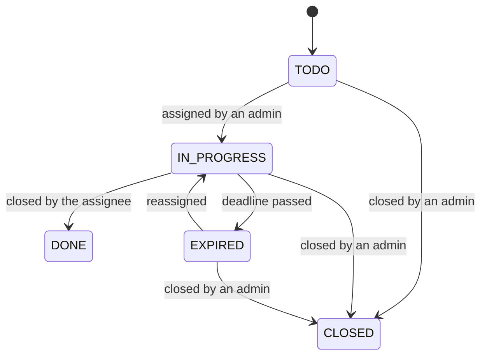
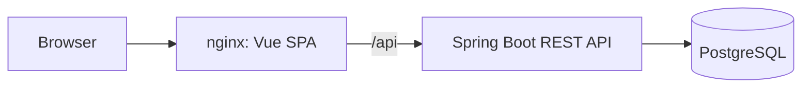

# BugBoard

A role-based issue tracker built with Spring Boot, Vue 3 and PostgreSQL, with containerized deployment and a CI/CD pipeline.

Team members report bugs, features, questions and documentation tasks. Administrators assign the work and set deadlines, and stakeholders follow bugs through a read-only dashboard.

Developed by a team of two for the Software Engineering course at the University of Naples Federico II.

## Features

- **Issue tracking:** type, priority, labels and an image attachment for each issue
- **Assignment workflow:** admins assign issues with an optional deadline, and assignees comment and close them
- **Notifications:** users are notified when an issue is assigned to them
- **Role-based dashboards:** a separate view for each role, with statistics, search and filters
- **Live updates:** dashboards refresh through polling every 5 seconds
- **Concurrent editing protection:** optimistic locking rejects changes based on stale data with a `409 Conflict`
- **User management:** admins create and delete accounts

### Roles

| Role | Permissions |
| --- | --- |
| **Admin** | View all issues, assign them, close them and manage users |
| **User** | Report issues, then comment on and complete the issues assigned to them |
| **Read-only** | View bugs and their details |

### Issue lifecycle



The backend reads and handles the `EXPIRED` status, but neither the backend nor `database/bugboard.sql` sets it when a deadline passes.

## Tech stack

| Area | Technologies |
| --- | --- |
| Backend | Java 17, Spring Boot 3, Spring Data JPA, Hibernate, Lombok |
| Frontend | Vue 3, Vue Router, Vite, Tailwind CSS, Axios |
| Database | PostgreSQL |
| Testing | JUnit, Mockito |
| Delivery | Docker, Docker Compose, nginx, GitHub Actions, GitHub Container Registry |

## Architecture

The browser talks only to the frontend container. nginx serves the single-page app and forwards `/api` requests to the backend, so the browser sees a single origin.



The backend follows a layered structure of controllers, services and repositories. Some of the main design choices:

- **Read and write separation:** controllers depend on separate query and command service interfaces for issues.
- **Builder pattern:** `IssueBuilder` centralizes issue creation, including enum conversion and image handling.
- **Event-driven notifications:** assigning an issue publishes `IssueAssegnataEvent`, and `NotificaListener` saves the notification, so the issue service stays independent of it.
- **Centralized error handling:** `GlobalExceptionHandler` converts application exceptions into HTTP responses.
- **Session authentication:** passwords are hashed with BCrypt. Login creates a session stored in the database, and the client sends its ID in the `X-Session-Id` header.

## Project structure

```text
.
├── backend/
│   └── src/
│       ├── main/java/bugboard/
│       │   ├── builder/      # Issue construction
│       │   ├── config/       # Application beans
│       │   ├── controller/   # REST endpoints and error handling
│       │   ├── dto/          # API request and response objects
│       │   ├── event/        # Domain events
│       │   ├── exception/    # Application exceptions
│       │   ├── listener/     # Event listeners
│       │   ├── mapper/       # Entity to DTO mapping
│       │   ├── model/        # JPA entities
│       │   ├── repository/   # Data access
│       │   └── service/      # Business logic
│       └── test/             # Unit tests
├── frontend/
│   └── src/
│       ├── components/       # Shared Vue components
│       ├── pages/            # Role-specific dashboards and auth pages
│       └── router/           # Routes and role guards
├── database/                 # PostgreSQL schema
├── deploy/                   # Production Compose files
└── .github/workflows/        # CI/CD pipeline
```

## Getting started

You need a PostgreSQL database. Create it from the schema:

```bash
createdb database_progetto
psql -d database_progetto -f database/bugboard.sql
```

Registration always creates a standard user. To get the first admin, set `role` to `ADMIN` for that user in the database.

### With Docker

```bash
cp .env.example .env    # then set the database URL, username and password
docker compose up --build
```

Open `http://localhost:8080`. When PostgreSQL runs on the host machine, use a host address that the containers can reach.

### Without Docker

JDK 21, Maven and Node.js are required. The backend compiles to Java 17, and Lombok 1.18.32 does not compile on JDK 25.

Create `backend/src/main/resources/application.properties`, which is ignored by Git:

```properties
spring.datasource.url=jdbc:postgresql://localhost:5432/database_progetto
spring.datasource.username=your_username
spring.datasource.password=your_password
spring.jpa.hibernate.ddl-auto=validate
spring.servlet.multipart.max-file-size=10MB
spring.servlet.multipart.max-request-size=12MB
```

Start the backend:

```bash
cd backend
mvn spring-boot:run
```

Start the frontend in a second terminal:

```bash
cd frontend
npm install
npm run dev
```

Open `http://localhost:5173`. Vite forwards `/api` requests to the backend on port 8080.

## API overview

Except for registration and login, endpoints identify the user through the `X-Session-Id` header.

| Area | Base path | Operations |
| --- | --- | --- |
| Authentication | `/api/auth` | Register, log in, log out |
| Issues | `/api/issues` | List, create, assign, comment, close, get details and images |
| Notifications | `/api/notifies` | Count, list, open, mark as read |
| Users | `/api/user` | List, create and delete users |

## Tests

The backend has 39 unit tests for the issue and user services, written with JUnit and Mockito. They do not need a database.

```bash
mvn -f backend/pom.xml test
```

## CI/CD

The GitHub Actions workflow in `.github/workflows/deploy.yml` has two stages:

1. **Pull requests to `main`:** run the backend tests and build the frontend.
2. **Pushes to `main`:** also build the Docker images, publish them to GitHub Container Registry and deploy them over SSH to separate frontend and backend servers.

Database credentials are stored on the servers, not in the images or the pipeline. See [DEPLOY.md](DEPLOY.md) for the deployment guide, written in Italian.

## Authors

- Rocco Molinari ([@rccmolinari](https://github.com/rccmolinari))
- Daniele Megna ([@daniele107](https://github.com/daniele107))
